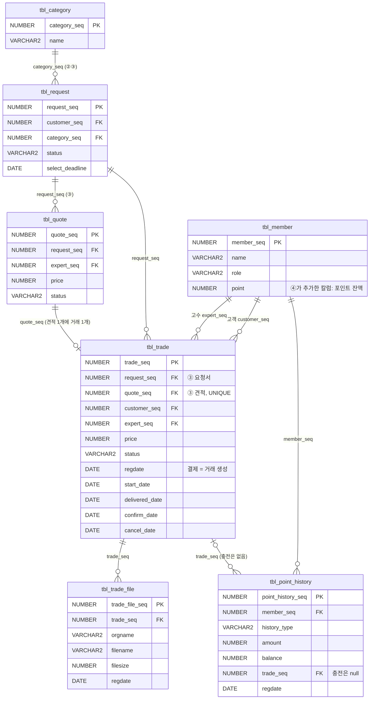

# ④ 결제·거래·통계 ERD

테이블 생성: `db/04_trade.sql` / 더미 데이터: `db/dummy/04_trade_dummy.sql`
흐름은 순서도 "④ 결제·거래·통계"를 따른다. 거래는 결제할 때 만들어진다.

## ④가 쓰는 다른 파트 테이블

`tbl_request`, `tbl_quote`는 ③의 `db/03_request.sql`, `tbl_category`는 ②의 `db/02_expert_profile__category__review.sql` 기준이다.

| 쓰는 곳 | 쓰는 칼럼 |
| --- | --- |
| `mappers/trade/TradeMapper.xml` 의 `getQuote`, `selectRequest`, `selectQuote`, `cancelRequest` | `tbl_request`: request_seq, customer_seq, status, select_deadline / `tbl_quote`: quote_seq, request_seq, expert_seq, price, status |
| `mappers/stats/StatsMapper.xml` 의 `categoryPrices` | `tbl_request`: request_seq, category_seq / `tbl_category`: category_seq, name |

④가 바꾸는 ③ 테이블 값

| 언제 | 테이블 | 바꾸는 값 |
| --- | --- | --- |
| 결제 | `tbl_request.status` | `OPEN`(모집 중) 또는 `CLOSED`(견적 마감)이고 고수 선택 마감 전일 때만 → `SELECTED`(선택 완료) |
| 결제 | `tbl_quote.status` | 고른 견적 → `SELECTED`(선택됨), 같은 요청서의 나머지 → `UNSELECTED`(미선택) |
| 거래 취소 | `tbl_request.status` | `SELECTED` → `CANCELED` (03_request.sql: 선택 완료 후 거래가 취소된 경우도 CANCELED) |

`04_trade.sql`이 `fk_trade_request`, `fk_trade_quote`를 걸기 때문에 03이 먼저 실행되어 있어야 한다.
`dummy/04_trade_dummy.sql`은 ③ 더미의 요청서 4 / 견적 4를 거래 하나에 쓰고, 나머지 거래는 요청서·견적을 직접 만들어서 쓴다.
② 리뷰의 `fk_review_trade`는 `04_trade.sql`에 주석으로 넣어 두었다. (② 테이블이 develop에 합쳐지면 푼다)

## 테이블 정의

### tbl_member (① 테이블에 칼럼 추가)

| 칼럼 | 자료형 | 제약 | 설명 |
| --- | --- | --- | --- |
| point | NUMBER | NOT NULL, DEFAULT 0, CHECK (point >= 0) | 포인트 잔액 |

### tbl_trade (거래)

| 칼럼 | 자료형 | 제약 | 설명 |
| --- | --- | --- | --- |
| trade_seq | NUMBER | PK (seq_trade) | 거래 번호 |
| request_seq | NUMBER | NOT NULL, FK 예정 | 요청서 (③) |
| quote_seq | NUMBER | NOT NULL, UNIQUE, FK 예정 | 선택한 견적 (③). 견적 하나로 거래 하나만 |
| customer_seq | NUMBER | NOT NULL, FK tbl_member | 고객 |
| expert_seq | NUMBER | NOT NULL, FK tbl_member | 고수 |
| price | NUMBER | NOT NULL, CHECK (price > 0) | 거래 금액 = 견적 금액 |
| status | VARCHAR2(20) | NOT NULL, DEFAULT 'PAID', CHECK | 거래 상태 (아래 표) |
| regdate | DATE | NOT NULL, DEFAULT sysdate | 결제 (거래 생성) |
| start_date | DATE | | 작업 시작 |
| delivered_date | DATE | | 납품 완료 |
| confirm_date | DATE | | 구매 확정 |
| cancel_date | DATE | | 취소 |

### tbl_trade_file (납품 결과물)

| 칼럼 | 자료형 | 제약 | 설명 |
| --- | --- | --- | --- |
| trade_file_seq | NUMBER | PK (seq_trade_file) | 파일 번호 |
| trade_seq | NUMBER | NOT NULL, FK tbl_trade | 거래 |
| orgname | VARCHAR2(300) | NOT NULL | 올린 파일 이름 |
| filename | VARCHAR2(400) | NOT NULL | 저장한 파일 이름 (UUID_원래이름) |
| filesize | NUMBER | NOT NULL | 바이트 |
| regdate | DATE | NOT NULL, DEFAULT sysdate | |

### tbl_point_history (포인트 내역)

| 칼럼 | 자료형 | 제약 | 설명 |
| --- | --- | --- | --- |
| point_history_seq | NUMBER | PK (seq_point_history) | 내역 번호 |
| member_seq | NUMBER | NOT NULL, FK tbl_member | 회원 |
| history_type | VARCHAR2(20) | NOT NULL, CHECK | 종류 (아래 표) |
| amount | NUMBER | NOT NULL | 들어오면 +, 나가면 - |
| balance | NUMBER | NOT NULL | 처리 후 잔액 |
| trade_seq | NUMBER | FK tbl_trade | 관련 거래 (충전은 null) |
| regdate | DATE | NOT NULL, DEFAULT sysdate | |

## 상태 값

### 거래 상태 (tbl_trade.status)

| 코드 | 화면 표시 | 언제 |
| --- | --- | --- |
| `PAID` | 결제 완료 | 고객이 포인트로 결제 (거래가 이때 만들어짐, 포인트는 플랫폼이 보관) |
| `IN_PROGRESS` | 진행 중 | 고수가 작업 시작 버튼을 누름 |
| `DELIVERED` | 납품 완료 | 고수가 작업 완료 버튼을 누름 (온라인 작업은 결과물 첨부) |
| `CONFIRMED` | 구매 확정 | 고객이 구매 확정 / 납품 후 7일이 지나 자동 확정 → 고수에게 정산 |
| `CANCELED` | 취소 | 고객이 작업 시작 전에 취소 → 포인트 환불, 요청서도 취소 |

### 포인트 내역 종류 (tbl_point_history.history_type)

| 코드 | 화면 표시 | 금액 |
| --- | --- | --- |
| `CHARGE` | 충전 | + |
| `PAY` | 결제 | - (플랫폼이 보관) |
| `SETTLE` | 정산 | + (구매 확정 후 고수에게, 수수료 없음) |
| `REFUND` | 환불 | + (거래 취소) |

## 통계 (E-05)

분류(요청서 카테고리)별 거래 건수, 평균 단가, 매출. 취소된 거래는 빼고, 결제일 기준으로 30일 / 90일 / 1년 / 전체 기간 중에서 고른다.
매출은 수수료가 없어서 구매 확정된 거래 금액 합계다.
